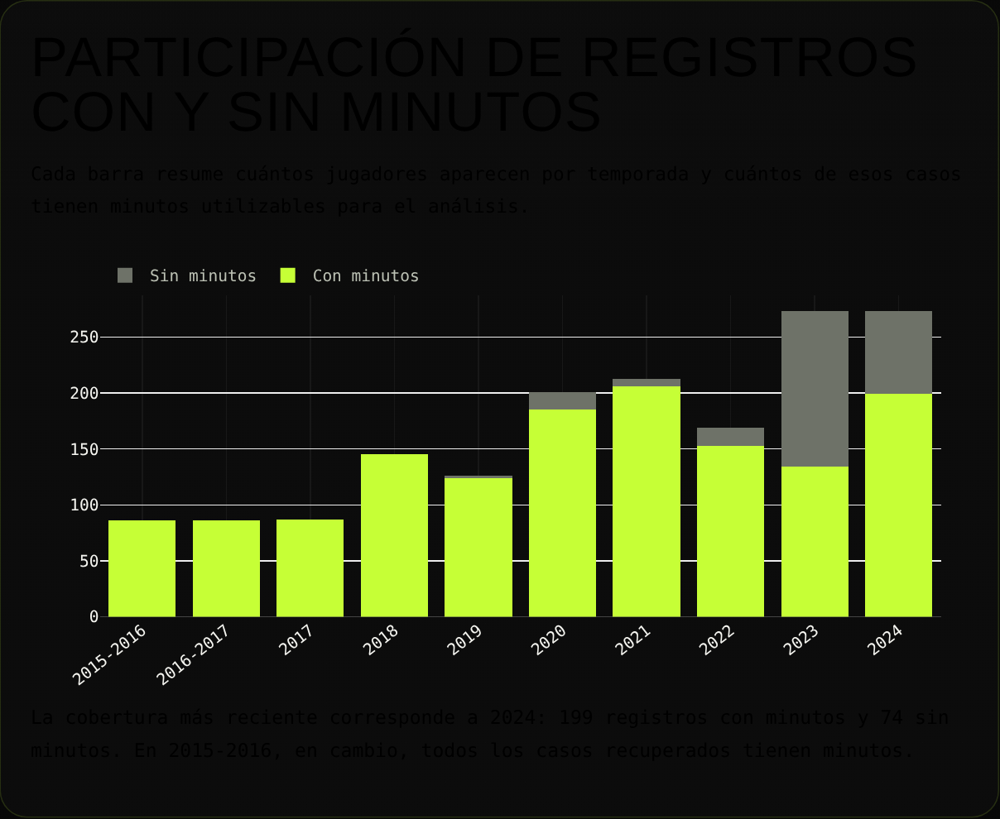
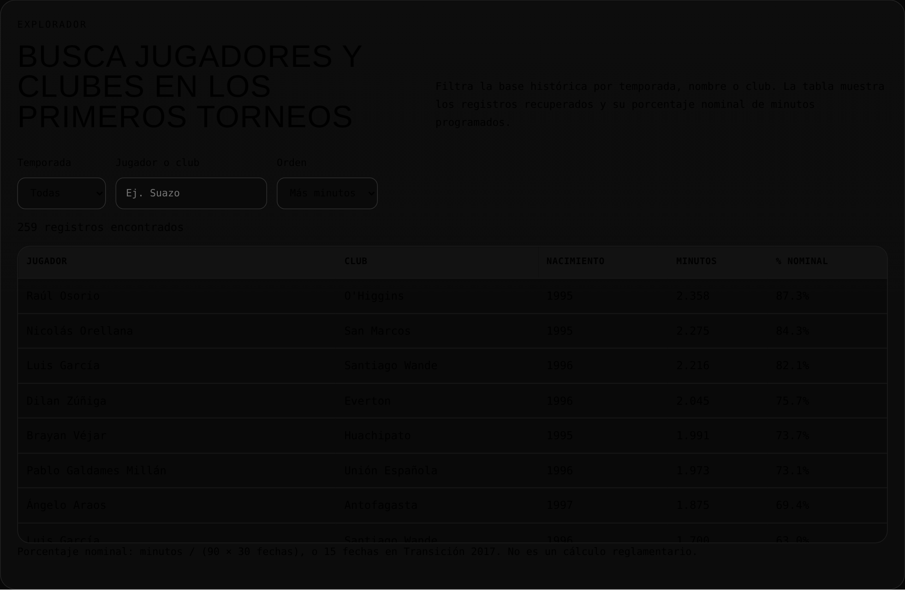
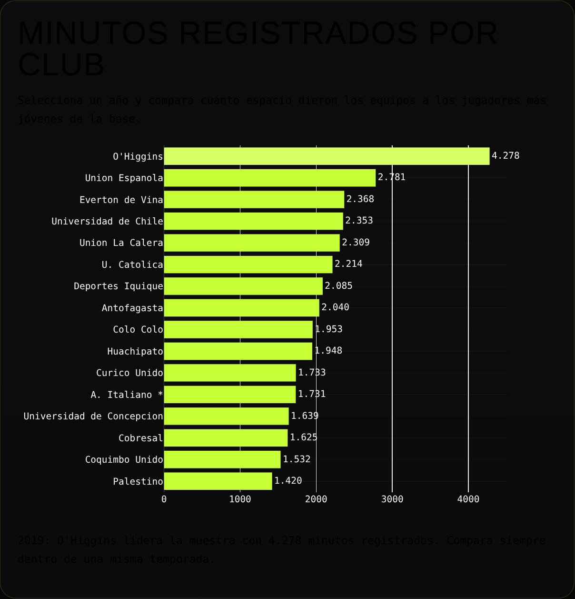
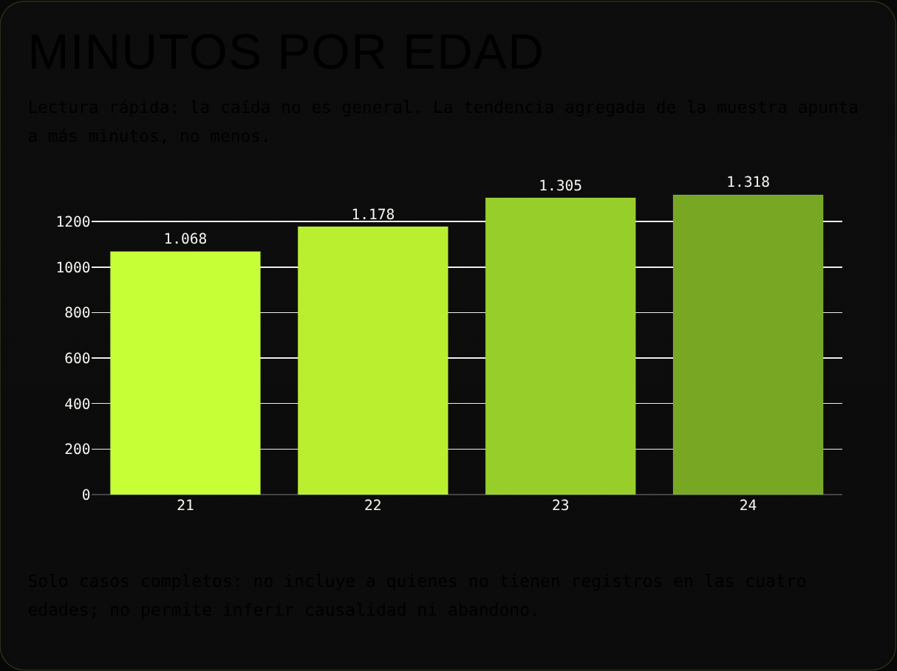

# Análisis de las visualizaciones — El mito del abismo

**Sofía Carvajal y Vicente Labbé | COM-208 | Entrega 05**

## Propósito y relación con nuestra hipótesis

Nuestra historia busca entender qué ocurre con las oportunidades de los futbolistas jóvenes en Primera División cuando dejan atrás los 21 años. Para responder esta pregunta, organizamos las visualizaciones en una secuencia que parte por la cobertura de los datos, permite explorar registros individuales, compara clubes y termina examinando la continuidad de los minutos. No buscamos presentar la cantidad de minutos como una medida absoluta del éxito profesional, sino como un indicador observable de participación en cancha.

## 1. Cobertura: diez años, dos fuentes

El gráfico de barras apiladas distingue los registros con minutos disponibles (verde) de aquellos sin minutos informados (gris). Su función es hacer visible la calidad de la evidencia antes de interpretar los resultados. Los diez períodos corresponden a los torneos disponibles entre 2015 y 2024; no todos tienen la misma duración ni la misma cobertura.

La base analítica contiene 1.659 registros, de los cuales 1.406 cuentan con minutos. En los tres torneos históricos recuperamos 259 registros con minutos. En 2023, en cambio, 139 de los 273 registros no tienen ese dato. Esta diferencia impide interpretar el crecimiento de registros como un aumento demostrado de debuts o de oportunidades.

**Interacción:** al tocar o pasar el cursor sobre las barras se consultan las cantidades de cada categoría. **Base:** [cobertura_beta.csv](base_datos/cobertura_beta.csv).

## 2. Explorador histórico: de las cifras a los jugadores

La tabla permite reconocer nombres, clubes y minutos detrás de las cifras agregadas. Su objetivo es que el lector pueda formular sus propias preguntas y contrastar casos concretos de los primeros tres torneos estudiados. El buscador acepta nombres o clubes; el selector permite elegir el torneo y el ordenamiento facilita encontrar a quienes acumularon más minutos o recorrer los nombres alfabéticamente.

El porcentaje nominal compara los minutos individuales con 90 minutos por 30 fechas programadas, o 15 en el torneo de Transición 2017. No equivale a la cuota reglamentaria ni acredita por sí solo la elegibilidad de un jugador.

**Base:** [juveniles_fbref_2015_2017.csv](base_datos/juveniles_fbref_2015_2017.csv).

## 3. Clubes: el espacio que dan los equipos

Esta visualización desarrolla la propuesta individual de Sofía en la Entrega 03, inicialmente centrada en 2019. En la beta se amplía la selección a los diez períodos disponibles. Elegimos barras horizontales ordenadas porque permiten comparar magnitudes y leer nombres extensos sin depender exclusivamente del color. Las etiquetas muestran los minutos y la explicación inferior identifica el mayor total observado de la temporada seleccionada.

La comparación permite reconocer diferencias en el minutaje registrado entre equipos dentro de un mismo torneo. No demuestra que un club tenga una mejor política formativa, ni acredita el cumplimiento de la regla juvenil. La edad al cierre del año es un criterio analítico, no la definición jurídica de elegibilidad. Los asteriscos señalan registros incompletos; no equiparamos un dato faltante a cero minutos. Tampoco comparamos directamente torneos de distinta duración. Los posibles totales acumulados de jugadores que cambiaron de equipo requieren verificación adicional.

**Interacción:** selector de temporada y detalles de cada barra. **Base:** [clubes_beta.csv](base_datos/clubes_beta.csv).

## 4. Trayectorias: qué pasa después de los 21

Esta visualización retoma la pregunta de la propuesta individual de Vicente sobre la continuidad de los futbolistas. En la versión ampliada, comparamos los minutos a los 21, 22, 23 y 24 años para 46 jugadores con información disponible en las cuatro edades en la fuente 2018–2024.

| Edad | Promedio de minutos | Mediana de minutos |
|---|---:|---:|
| 21 | 1.068 | 909 |
| 22 | 1.178 | 1.083 |
| 23 | 1.305 | 1.536 |
| 24 | 1.318 | 1.289 |

La comparación permite matizar nuestra hipótesis: el promedio no disminuye entre los 21 y los 24 años en esta muestra. De los 46 jugadores, 29 aumentan sus minutos y 17 los reducen. La mediana muestra un retroceso entre los 23 y los 24, aunque sigue por encima del valor de los 21. Por eso evitamos confundir una tendencia agregada con una trayectoria universal.

El selector entre promedio y mediana permite examinar el efecto de los valores extremos. Esta muestra de casos completos puede dejar fuera a futbolistas con trayectorias discontinuas o información insuficiente; por ello no permite determinar qué proporción abandona el fútbol, ni el efecto causal de la regla juvenil. Los minutos son absolutos y no están ajustados por la duración de cada temporada.

**Bases:** [edades_beta.csv](base_datos/edades_beta.csv) y [comparacion_edades_completa.csv](base_datos/comparacion_edades_completa.csv).

## Implementación, fuentes y replicabilidad

Los gráficos de la beta utilizan Plotly.js y JavaScript. La preparación de datos utiliza Python y pandas. El código de procesamiento se encuentra en [generar_beta.py](codigo/generar_beta.py), y las interacciones en [script.js](codigo/script.js), junto a los archivos HTML, CSS y `data.js`. Las visualizaciones anteriores se conservan como antecedentes, no como la versión vigente del sitio. Las imágenes de esta página corresponden a referencias de la beta rediseñada.

Fuentes: [FBref 2015–2016](https://fbref.com/en/comps/35/2015-2016/stats/2015-2016-Liga-de-Primera-Stats), [FBref 2016–2017](https://fbref.com/en/comps/35/2016-2017/stats/2016-2017-Liga-de-Primera-Stats), [FBref 2017](https://fbref.com/en/comps/35/2017/stats/2017-Liga-de-Primera-Stats) y [API Classificação Geral (ejemplo 2018)](https://api.classificacaogeral.com.br/v1/competitions/265/editions/2018/players). Véase la [ficha técnica de la beta](base_datos/Ficha_Tecnica_beta.md).

## Próxima iteración

Para la versión posterior a la beta, queda planificado cotejar los cruces históricos de identidad y los casos faltantes, revisar los posibles totales acumulados, evaluar una normalización por duración de torneo y probar la comprensión de los gráficos con lectores. Estas tareas permitirían ampliar el seguimiento sin convertir la falta de información en una conclusión sobre abandono deportivo.
